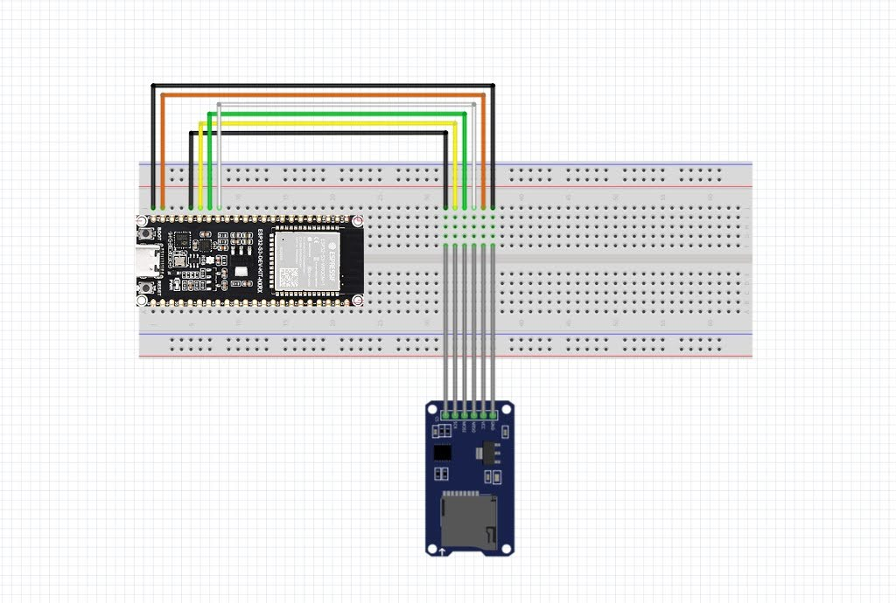

# seedsigner-esp32-bootloader

Stateless secure bootloader for the SeedSigner ESP32 platform. Supports
**ESP32-P4** and **ESP32-S3** targets from a single unified codebase.

Boot chain:

1. **Secure Boot V2** — the 2nd-stage bootloader verifies the loader image
   against the eFuse-stored key digest on every boot.
2. **Loader** (`seedsigner_secure_loader.bin`) — mounts the SD card, reads
   `seedsigner_esp32p4.bin` or `seedsigner_esp32s3.bin`, verifies its
   secp256k1 multisig signature against `vendor_keys[]` (compiled in from
   `keys/<profile>/vendor_keys.c`), shows an anti-phishing proof, then loads
   and jumps to the MicroPython firmware from PSRAM.

Two independent key pairs protect this chain:

| Layer | Key | Purpose | Protects |
|---|---|---|---|
| 1 | RSA secure-boot signing key | bootloader image signing | loader image in flash |
| 2 | ECDSA secp256k1 payload key | payload bundle signing | SD-card firmware bundle |

Both private keys are gitignored and must be generated locally, never commit them.

## Demos

### ESP32-P4

[](https://www.youtube.com/watch?v=jkk55UFmpCI)

### ESP32-S3

[](https://www.youtube.com/watch?v=al7gvf-3Q34)

## Supported Targets

| Target | Board | PSRAM | Secure Boot | Status |
|---|---|---|---|---|
| **ESP32-P4** | Waveshare ESP32-P4 WiFi6 Touch LCD 4.3 | 32MB | V2 (RSA-3072) | Working |
| **ESP32-S3** | Waveshare ESP32-S3-Touch-LCD-3.5B (N8R8) / ESP32-S3-DEV-KIT-N8R8 | 8MB Octal | V2 (RSA-3072) | Working |

### ESP32-S3 SD Card Wiring

On ESP32-S3 modules with Octal PSRAM (`N8R8`), GPIOs 33–37 are reserved internally for the MSPI interface. The bootloader interfaces with an external MicroSD module (such as the standard HW-125 with level shifters or native SPI) over `SPI2_HOST` (SDSPI) with automatic SDMMC 1-bit fallback using the following pinout:

| ESP32-S3 Pin | Signal (SDSPI) | Signal (SDMMC) | MicroSD Module (HW-125) |
|---|---|---|---|
| **`GND`** (Pin 1) | `GND` | `GND` | **Pin 1 (`GND`)** |
| **`5V`** (Pin 2) | `VCC` (5V to LDO) | `VCC` | **Pin 2 (`VCC`)** |
| **`GPIO 12`** (Pin 5) | `CS` (Chip Select) | `D2` | **Pin 6 (`CS`)** |
| **`GPIO 11`** (Pin 6) | `SCK` (Clock) | `CLK` | **Pin 5 (`SCK`)** |
| **`GPIO 10`** (Pin 7) | `MOSI` (Host → Card) | `CMD` | **Pin 4 (`MOSI`)** |
| **`GPIO 9`** (Pin 8) | `MISO` (Card → Host) | `D0` | **Pin 3 (`MISO`)** |



## Prerequisites

- ESP-IDF v5.5 (`export.sh` sourced, or set `IDF_PATH`)
- Python deps for the payload tooling: `pip install ecdsa bech32`
- `seedsigner-micropython-builder` fork:
  https://github.com/wolgwang1729/seedsigner-micropython-builder

## Layer 1: Secure-boot signing key (RSA)

```bash
# Both targets select Secure Boot V2 with the RSA-3072 scheme
# (CONFIG_SECURE_SIGNED_APPS_RSA_SCHEME), so the key MUST be RSA-3072:
espsecure.py generate_signing_key --version 2 --scheme rsa3072 secure_boot_signing_key.pem
```

> Modern esptool defaults `generate_signing_key` to ECDSA-P256. An ECDSA key
> makes the 2nd-stage bootloader reject every image with
> "RSA signing scheme selected but signature block generated for ECDSA scheme".

This key signs the bootloader and the loader image. Its digest is stored in the
eFuse and checked at every boot. `sdkconfig.defaults` already references it via
`CONFIG_SECURE_BOOT_SIGNING_KEY="secure_boot_signing_key.pem"`.

> Dev note: this project uses virtual eFuses (`CONFIG_EFUSE_VIRTUAL=y`), so the
> key digest lives in the `efuse` flash partition, not burned silicon. Safe to
> iterate on real hardware.

## Layer 2: Vendor payload signing key (ECDSA secp256k1)

```bash
python3 tools/generate_vendor_key.py [--profile test|production]
```

This generates `payload_signing_key.pem` (gitignored) and writes the matching
`vendor_keys[]` C file to `keys/<profile>/vendor_keys.c`. The loader verifies
the SD payload against this public key, so the two must match or the firmware
won't boot.

The key profile is a CMake cache variable that selects which keys file the
build compiles:

```bash
# test is the default profile (dev only)
idf.py build
# production keys (hold the private key offline!)
idf.py -DVENDOR_KEYS_PROFILE=production build
```

Pass `-D` to switch profiles — it rewrites `CMakeCache.txt` (a configure
dependency), so the change always takes effect. Do NOT rely on the
`VENDOR_KEYS_PROFILE` env var to switch: it is only read at configure time and
never retriggers a reconfigure, so it would silently keep the previously
configured profile. A divergent env var is called out as a build warning.

If you regenerate the key, `keys/<profile>/vendor_keys.c` is rewritten
automatically — just rebuild the loader. `tools/generate_signed_payload.py`
warns if the payload signing key doesn't match the compiled keys file.

## Building the MicroPython firmware (SD payload)

Use the fork: https://github.com/wolgwang1729/seedsigner-micropython-builder

The ESP32-S3 stateless shim lives on the `esp32s3-stateless-boot` branch.

```bash
git clone https://github.com/wolgwang1729/seedsigner-micropython-builder
cd seedsigner-micropython-builder

# For ESP32-P4 (main branch):
make docker-build-all BOARD=WAVESHARE_ESP32_P4_WIFI6_TOUCH_LCD_43

# For ESP32-S3 (esp32s3-stateless-boot branch):
git checkout esp32s3-stateless-boot
make docker-build-all BOARD=WAVESHARE_ESP32_S3_TOUCH_LCD_35B
```

The raw firmware lands at `build/<BOARD>/micropython.bin`.

## Signing the payload bundle

```bash
# For ESP32-P4 (default):
python3 tools/generate_signed_payload.py <micropython.bin> seedsigner_esp32p4.bin

# For ESP32-S3:
python3 tools/generate_signed_payload.py --platform seedsigner_esp32s3 \
    <micropython.bin> seedsigner_esp32s3.bin
```

Copy the resulting `.bin` to the **root of a FAT32 SD card** and insert it
into the board — or push it directly over UART with no card ejection (see below).

## Pushing the payload without ejecting the SD card (RAM uploader)

Ported from `specter-bootloader`'s `sd_uploader` idea: a tiny RAM-only app is
loaded into SRAM via `esptool load_ram` and streams the file to the SD card
over the same USB-UART cable (atomic `.part` + double SHA-256 readback publish,
per-chunk CRC-32; never touches flash/eFuses, never formats).

```bash
# ESP32-P4:
./run.sh --target esp32p4 upload-sd seedsigner_esp32p4.bin

# ESP32-S3:
./run.sh --target esp32s3 upload-sd seedsigner_esp32s3.bin

# Options: --port /dev/ttyUSB0 --baud 2000000 --name custom.bin
#          --no-monitor (skip the serial monitor at the end)
```

This builds `uploader/` for the target, `load_ram`s
`uploader/build/<target>/seedsigner_sd_uploader.bin`, uploads, verifies, and
releases — then resets the board into the flashed loader and opens the serial
monitor so you watch it boot the new payload (same ending as `run.sh ...
all`). Re-running with an unchanged file skips the transfer (`SKIPPED`) and
goes straight to reset + monitor.
`tools/sd_upload.py` also works standalone (`status|list|verify|remove|
release`; every command loads the RAM image first in the same process).
See [`uploader/README.md`](uploader/README.md).

## Flashing

```bash
# ESP32-S3 (default target):
bash run.sh --target esp32s3

# ESP32-P4:
bash run.sh --target esp32p4
```

This builds the loader, flashes the bootloader, partition table, and loader
(secure-boot signed) to the board at 921600 baud, and opens the serial monitor.
Default port is `/dev/ttyACM0`; override with `ESPPORT=...`. Wait for the
anti-phishing words and the MicroPython REPL prompt (`>>>`).

To flash without rebuilding: `bash run.sh --target <target> flash`

## Emulator test — full boot chain, no hardware (`tools/emu/`)

`tools/emu/run_emu_ci.sh` builds a scratch copy of this repo with the
emulation-only overlay `emu-flash-payload.patch` (signed bundle served from raw
flash instead of the SD card, which esp-emu does not model), signs
`PAYLOAD_BIN`, merges a flash image, boots it in
[esp-emu](https://github.com/espressif/esp-emulator), injects CR-terminated
MicroPython commands and checks the loader-signature/banner/REPL markers. The
repo itself is never modified.

```bash
# one-shot local run (esp-emu >= 0.49 on PATH; ESP-IDF export sourced)
PAYLOAD_BIN=build/<BOARD>/micropython.bin tools/emu/run_emu_ci.sh all s3

# ESP32-P4 uses the rev-1.3 route matching the physical boards (rev0 ROM ELF +
# rev1.3 virtual eFuse; pre-v3 MicroPython images do not execute on esp-emu's
# default rev-3.1 model):
P4_REV0_ROM=<...>/esp32p4_rev0_rom.elf \
PAYLOAD_BIN=build/<BOARD>/micropython.bin tools/emu/run_emu_ci.sh all p4
```

`build`, `run`, and `all` can be split across steps/containers via `SCRATCH`
(the merged image `SCRATCH/emu_<t>.bin` and log `SCRATCH/emu_<t>.log` land
there). CI runs the same script in the `emulator-repl` job of
[`.github/workflows/ci.yml`](.github/workflows/ci.yml) for both targets.

## Repository layout

See [`docs/code_structure.md`](docs/code_structure.md) for the module map and
boot-chain data flow. In short: `main/main.c` orchestrates; target-specific
modules in `main/targets/<chip>/` handle SD-card I/O (`storage_*.c`) and the
bare-metal MMU/copy/jump sequence (`jump_*.c`). `main/esp_image.c` parses the
ESP32 image into a load plan. Vendor keys are compiled in from
`keys/<profile>/`.
